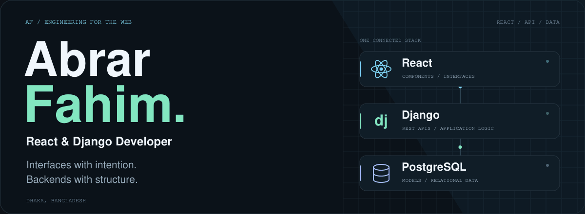
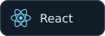
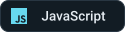
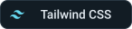
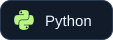
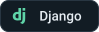
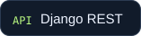
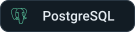
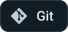
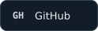

<picture>
  <source media="(prefers-reduced-motion: reduce) and (prefers-color-scheme: dark)" srcset="./assets/hero-dark.png">
  <source media="(prefers-reduced-motion: reduce) and (prefers-color-scheme: light)" srcset="./assets/hero-light.png">
  <source media="(prefers-color-scheme: dark)" srcset="./assets/hero-dark.gif">
  <source media="(prefers-color-scheme: light)" srcset="./assets/hero-light.gif">
  
</picture>

  <a href="https://abrarfahimx.vercel.app"><strong>Portfolio ↗</strong></a>
  &nbsp; · &nbsp;
  <a href="mailto:dev.abrarfahim@gmail.com"><strong>Say hello ↗</strong></a>
  &nbsp; · &nbsp;
  <a href="https://github.com/abrarfahimabir?tab=repositories"><strong>Explore my code ↗</strong></a>

## A little about me

I'm **Abrar Fahim**, a **React & Django developer** based in **Dhaka, Bangladesh**, and a **Computer Science & Engineering student at Green University of Bangladesh**.

I enjoy bringing the two sides of the web together: thoughtful, responsive interfaces on the frontend, and clear APIs and structured application logic on the backend.

## My everyday stack

  
  
  

  
  
  
  

  
  

## Selected work

### [NEXT LMS](https://github.com/abrarfahimabir/NEXT-LMS-)

A learning management system connecting course enrollment and content delivery with a Django REST API and a JWT-secured React frontend.

`React` `Django REST Framework` `JWT` `Tailwind CSS`

[Explore the repository ↗](https://github.com/abrarfahimabir/NEXT-LMS-) · [Visit the app ↗](https://sslms.vercel.app)

### [Ostad Blog](https://github.com/abrarfahimabir/Ostad.Blog)

A Django blogging application for publishing and managing articles, with a responsive reading experience.

`Django` `Python` `HTML` `CSS` `Bootstrap` `SQLite`

[Explore the repository ↗](https://github.com/abrarfahimabir/Ostad.Blog)

---

**Have a project in mind?** [Let's talk ↗](mailto:dev.abrarfahim@gmail.com)

Building from Dhaka, Bangladesh. One thoughtful detail at a time.
