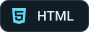
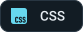

<!-- HERO:START (generated from profile.config.json, do not edit inside this block) -->
<picture>
  <source media="(max-width: 600px) and (prefers-reduced-motion: reduce)" srcset="assets/hero-compact-static.svg">
  <source media="(max-width: 600px)" srcset="assets/hero-compact.svg">
  <source media="(prefers-reduced-motion: reduce)" srcset="assets/hero-static.svg">
  
</picture>
<!-- HERO:END -->

  React on the front, Django behind it, and a clean API in between.

  
  &nbsp;
  

## About

I'm Abrar, a Computer Science & Engineering student at Green University of Bangladesh. Most of what I build follows the same shape: a React interface talking to a Django backend. I enjoy both ends of that connection, from modelling data and writing REST endpoints in Django to turning the responses into screens that feel simple to use.

Lately I've been focusing on the parts that make an app hold up in real use: authentication, role-based permissions, and keeping the frontend and the API in sync.

## Tech stack

<!-- STACK:START (generated from profile.config.json, do not edit inside this block) -->

<b>Frontend</b> 

<b>Backend</b> 

<b>Tools</b> 

<!-- STACK:END -->

## Featured projects

### SkillStream: a learning management system

Instructors create courses, students enroll and track their progress, and admins manage everyone, all in one app with role-based access.

- **Interface:** React, React Router, Tailwind CSS, Recharts, Framer Motion
- **API:** Django, Django REST Framework, SimpleJWT, PostgreSQL in production and SQLite locally
- **Inside:** a custom user model with admin, instructor and student roles; courses split into modules and lessons; per-lesson progress; JWT login with rotating refresh tokens; protected routes on the frontend and authenticated endpoints by default on the API.

[Repository](https://github.com/abrarfahimabir/NEXT-LMS-) · [Live demo](https://sslms.vercel.app)

### Ostad Blog: blogging with per-post visibility

A Django blog where each author decides who can read a post: everyone, only themselves, or a chosen list of users.

- **Interface:** Django templates, Bootstrap 5, HTML, CSS
- **Backend:** Django class-based views, Python, SQLite
- **Inside:** sign-up and login, author-only editing and deleting, and a per-post share list that the views check before showing anything.

[Repository](https://github.com/abrarfahimabir/Ostad.Blog) · [Live demo](https://ostad-blog-b0f9.onrender.com/)

Both demos run on free hosting, so the first request can take up to a minute while the server wakes up.

## GitHub activity

<!-- ACTIVITY:START (generated by the "Update profile" workflow, do not edit inside this block) -->

**Language mix** across public repositories, by code size 
JavaScript 48% · CSS 22% · Python 17% · HTML 13%

**Recently pushed**

- [NEXT-LMS-](https://github.com/abrarfahimabir/NEXT-LMS-) · JavaScript · 4 May 2026
- [Ostad.Blog](https://github.com/abrarfahimabir/Ostad.Blog) · HTML · 5 Apr 2026
- [practice-git](https://github.com/abrarfahimabir/practice-git) · Python · 31 Mar 2026

From the public GitHub API · checked weekly · snapshot November 2026
<!-- ACTIVITY:END -->

## Connect

- **Portfolio:** [abrarfahimx.vercel.app](https://abrarfahimx.vercel.app)
- **Email:** [dev.abrarfahim@gmail.com](mailto:dev.abrarfahim@gmail.com)

If you're working with React and Django too, or you have a question about one of these projects, my inbox is open.

 

Building from Bangladesh, one request and response at a time.

