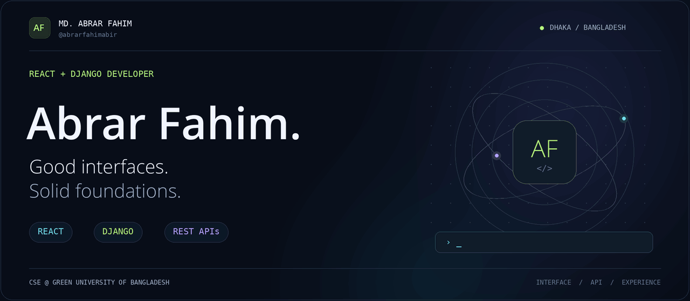
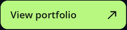
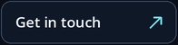
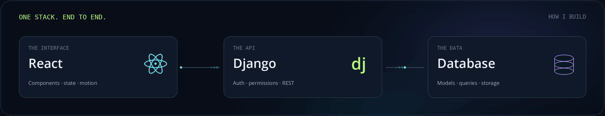
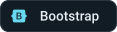
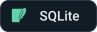
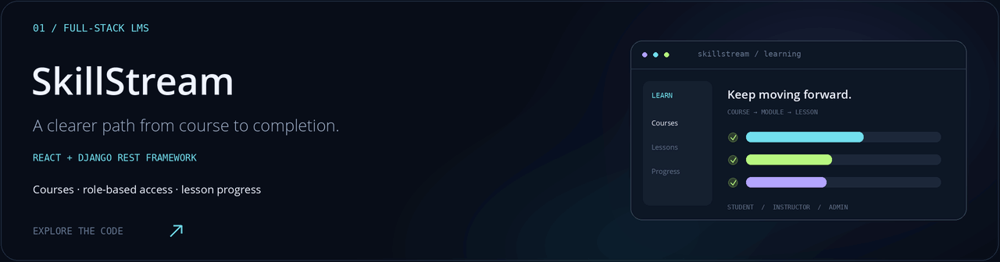
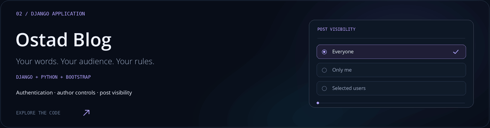
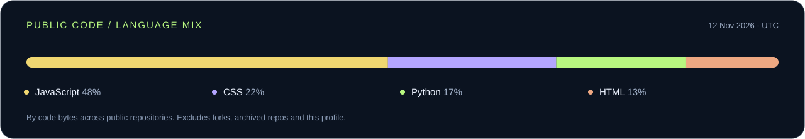
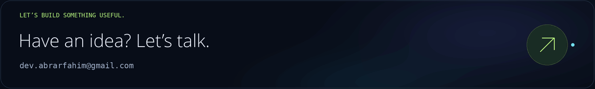

<picture>
  <source media="(max-width: 600px) and (prefers-reduced-motion: reduce)" srcset="assets/hero-mobile-still.png">
  <source media="(max-width: 600px)" srcset="assets/hero-mobile.gif">
  <source media="(prefers-reduced-motion: reduce)" srcset="assets/hero-still.png">
  
</picture>

  <b>React on the surface. Django at the core.</b> 
  Building web experiences that feel good to use and make sense behind the scenes.

  
  &nbsp;
  

## A little about me

I'm **Abrar**, a Computer Science & Engineering student at **Green University of Bangladesh**, based in Dhaka. I work with **React, Python and Django** to connect thoughtful interfaces with useful backend logic.

My projects range from a learning management system to a Django blog with per-post visibility. I enjoy the details that tie an app together: clear UI states, clean API responses, authentication and permissions.

## My everyday stack

<picture>
  <source media="(prefers-reduced-motion: reduce)" srcset="assets/stack-flow-still.png">
  
</picture>

**Interface**

  
  
  
  

**Backend & data**

  
  
  
  
  

**Tools & delivery**

  
  
  

## Selected work

<a href="https://github.com/abrarfahimabir/NEXT-LMS-">
  <picture>
    <source media="(prefers-reduced-motion: reduce)" srcset="assets/skillstream-still.png">
    
  </picture>
</a>

### SkillStream · Learning management system

A full-stack platform for creating courses and tracking learning progress, with separate roles for **students, instructors and admins**.

**Built with:** React · Tailwind CSS · Framer Motion · Django REST Framework · JWT

[View repository ↗](https://github.com/abrarfahimabir/NEXT-LMS-) &nbsp; · &nbsp; [Open live demo ↗](https://sslms.vercel.app)

 

<a href="https://github.com/abrarfahimabir/Ostad.Blog">
  <picture>
    <source media="(prefers-reduced-motion: reduce)" srcset="assets/ostad-blog-still.png">
    
  </picture>
</a>

### Ostad Blog · Publishing with control

A Django blog where authors choose who can read each post: **everyone, only themselves or selected users**. Includes sign-up, login and author-only editing and deletion.

**Built with:** Python · Django · Bootstrap · SQLite

[View repository ↗](https://github.com/abrarfahimabir/Ostad.Blog)

The cards above are custom illustrations of project features.

## A snapshot of my public code

<!-- ACTIVITY:START -->

JavaScript 48% · CSS 22% · Python 17% · HTML 13%

**Recently pushed**

- [NEXT-LMS-](https://github.com/abrarfahimabir/NEXT-LMS-) · JavaScript · 4 May 2026
- [Ostad.Blog](https://github.com/abrarfahimabir/Ostad.Blog) · HTML · 5 Apr 2026

Public GitHub API · refreshed weekly · checked 12 Nov 2026 (UTC). Repository push dates are separate from this snapshot date.
<!-- ACTIVITY:END -->

## Let's connect

<a href="mailto:dev.abrarfahim@gmail.com">
  <picture>
    <source media="(prefers-reduced-motion: reduce)" srcset="assets/contact-still.png">
    
  </picture>
</a>

  <a href="https://abrarfahimx.vercel.app">Portfolio</a> &nbsp; / &nbsp;
  <a href="mailto:dev.abrarfahim@gmail.com">Email</a> &nbsp; / &nbsp;
  <a href="https://github.com/abrarfahimabir?tab=repositories">All repositories</a>

Made with curiosity. Built from Bangladesh.

